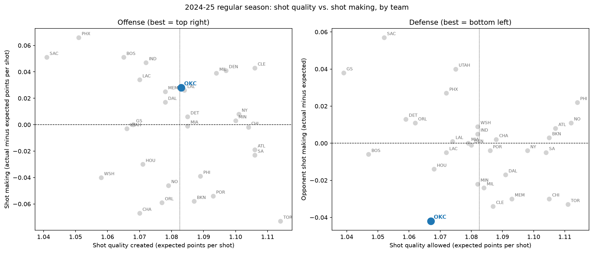

# NBA Shot Quality: Expected Points (xP) and Team Analysis, 2024-25

## Question
Which teams create and allow the best shots, and which teams' results beat or fall short of what shot location and shot type alone predict? The focus is the Oklahoma City Thunder.

Modern basketball is decided by shot quality as much as by shooting percentage. A team that takes good shots and misses is in a different situation from a team that takes bad shots and makes them, and separating the two shows where a team's results come from.

## Data
- ESPN play-by-play for the 2024-25 NBA season, loaded with the `sportsdataverse` Python package. Each shot has x/y coordinates on a full court in feet.
- I first tried the NBA stats site (`nba_api`), but it never responded from any of my networks, so I switched sources.
- After removing free throws and shots over 40 ft: 219,683 regular-season field goal attempts. Playoffs and the play-in tournament were excluded. About 180 All-Star game shots are in the model data and are dropped from the team tables.

## Method
1. **Checked the coordinates before using them.** Distance computed from x/y matches the distance written in the play description (for example "14-foot jump shot") to within 2 ft for 99.7% of 172,565 shots (mean error 0.74 ft).
2. **Put every shot on one hoop.** Shots at the left basket were rotated 180 degrees, so a shot 10 ft from either hoop counts as the same location.
3. **Features:** distance, angle to the hoop, three-pointer or not, and shot type (layup, pullup, step back, and so on).
4. **Models:** a logistic regression baseline and a gradient boosting model. Both were trained on the earliest 80% of shots by date and tested on the latest 20% (44,316 shots), so the test uses later games the models never saw.
5. **Expected points (xP)** = predicted probability of a make times the shot's value (2 or 3).
6. **Team analysis:** every shot got an out-of-sample prediction (5-fold cross-validation, split by game). Shot quality = average xP per shot. Shot making = actual points per shot minus xP.

## Model results (test set, 44,316 shots)

| Model | Log loss | AUC |
|---|---|---|
| League-average make rate for every shot | 0.6918 | n/a |
| Logistic regression | 0.6633 | 0.638 |
| Gradient boosting + shot type | 0.6403 | 0.656 |

The biggest improvement is at the rim (0-4 ft), where the actual make rate was 68.0%. Logistic regression predicted 61.4% and gradient boosting 66.3%. A straight-line model cannot capture how sharply make rate rises near the basket.

## Team results (30 teams, 2024-25 regular season)

- **OKC defense:** opponents scored 1.025 points per shot against an expected 1.067, a gap of -0.042. That was the largest gap of any of the 30 teams (next: Cleveland at -0.034, Toronto at -0.033).
- OKC allowed the highest share of corner threes in the league by my approximate definition (13.1% of opponent shots against 10.5% for the league). It also allowed a below-average share of shots at the rim (23.4% against about 26.4% for the league).
- **OKC offense:** average shot quality (16th of 30) and slightly better than expected shot making (+0.028 points per shot).

OKC's defense looks like one that gives up shots from the corners and keeps opponents away from the rim, and the opponents made fewer of those shots than the model expected. That fits a defense that makes teams shoot over contests, but this data cannot show it, because the model does not know how closely any shot was guarded. The next thing I would check is whether the gap holds in both halves of the season, and then add defender distance to see how much of it that explains.

## Limitations
- The model has no defender distance and no shooter identity, so the gap between actual and expected points mixes defense, shooter quality and luck. It does not show that OKC's defense caused the misses.
- One season. With about 7,200 shots per team, my rough estimate of the noise in points per shot is around plus or minus 0.014, and across 30 teams one will always look extreme. I have not tested whether the gap holds up across halves of the season.
- ESPN coordinates are not the NBA's official tracking data.
- The corner-three region is an approximation.
- The model ignores free throws, turnovers and offensive rebounds.

## Next steps
Test whether team gaps persist from one half-season to the next, add closest-defender distance from tracking data, add shooter skill with shrinkage, and extend to more seasons.

## How to run it
Requires Python 3.13 (what I used). On a Mac, also run `brew install libomp`. Install `pandas numpy matplotlib scikit-learn sportsdataverse pyarrow`, then run in order:

1. `python pull_pbp.py` downloads the season of play-by-play and saves shot attempts
2. `python build_features.py` removes free throws, flips shots to one hoop, computes distance and angle
3. `python verify.py` checks the coordinates against the stated distances
4. `python shot_map.py` draws the shot map
5. `python xp_model.py` runs the logistic regression baseline
6. `python xp_gbm.py` runs the gradient boosting model and compares the two
7. `python team_xp.py` computes team shot quality and shot making
8. `python team_chart.py` draws the team chart